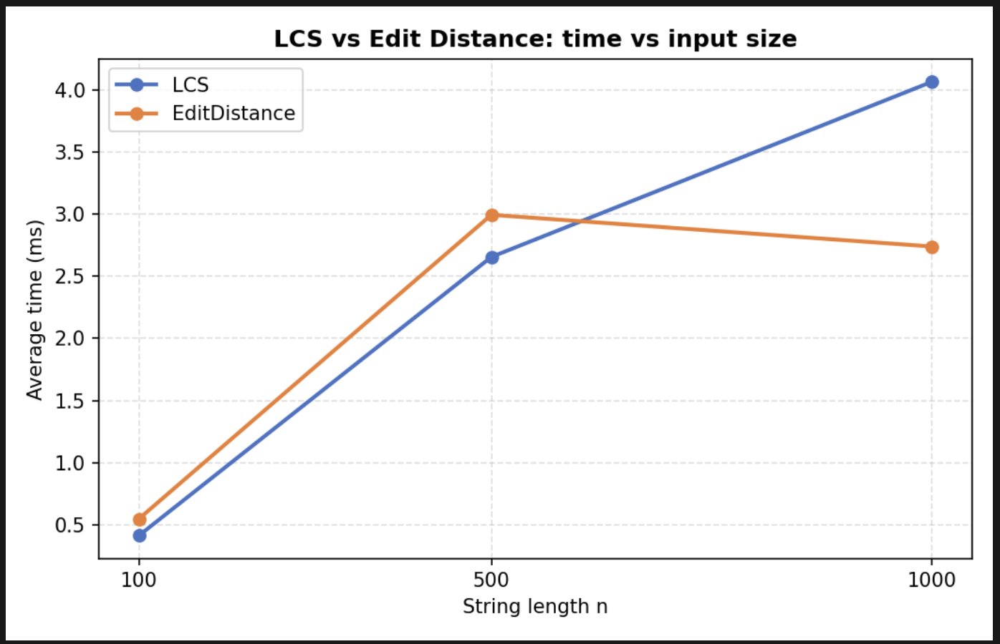
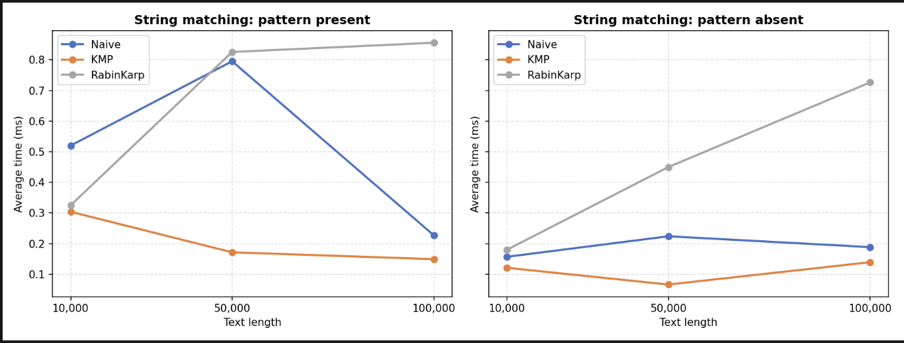
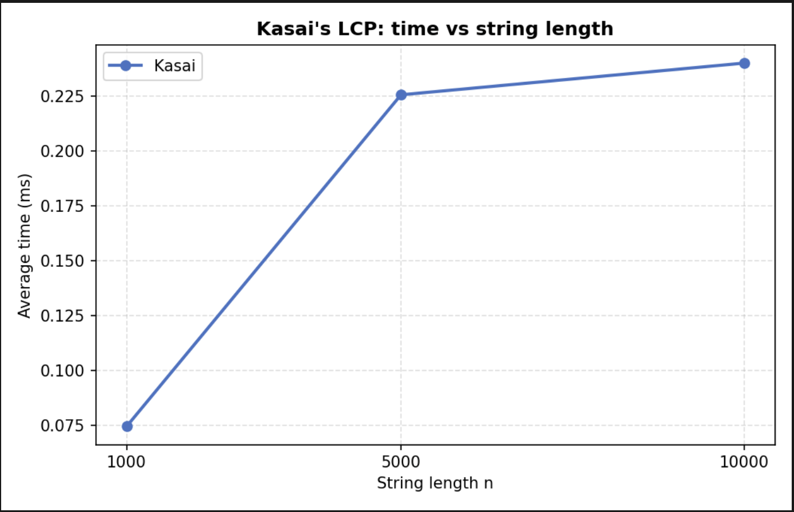

# Assignment 4 — Dynamic Programming and String Algorithms

**Project:** Asik4_DAA  
**Name:** Khanzada.N.A  
**Group:** SE-2539
## 1. Introduction

This project implements and analyzes several algorithms for dynamic programming, string matching, and suffix array processing.
The main goal is to understand how different algorithms solve string-related problems, compare their time complexity, and evaluate their practical performance through experiments.

The project includes:

- Longest Common Subsequence (LCS)
- Levenshtein Edit Distance
- Naive String Matching
- Knuth–Morris–Pratt (KMP)
- Rabin–Karp
- Kasai's LCP Array Construction

## 2. Project Structure

```text
Asik4_DAA/
├── data/
│   └── results.csv
├── plots/
│   ├── dp_execution_time.png
│   ├── string_matching_time.png
│   └── kasai_execution_time.png
├── src/
│   ├── main/java/org/example/
│   │   ├── Main.java
│   │   ├── dp/
│   │   │   ├── LCS.java
│   │   │   └── EditDistance.java
│   │   ├── matching/
│   │   │   ├── NaiveSearch.java
│   │   │   ├── KMP.java
│   │   │   └── RabinKarp.java
│   │   ├── suffix/
│   │   │   └── Kasai.java
│   │   └── experiment/
│   │       └── ExperimentRunner.java
│   └── test/java/org/example/
│       └── AlgorithmTests.java
├── pom.xml
└── README.md
```

## 3. Dynamic Programming Algorithms

### 3.1. Longest Common Subsequence (LCS)

**Purpose:** Find the length of the longest subsequence common to two strings. The characters must appear in the same relative order, but they do not need to be consecutive.
Let `dp[i][j]` represent the LCS length of the first `i` characters of string `A` and the first `j` characters of string `B`.

**Base cases:**

- `dp[i][0] = 0`
- `dp[0][j] = 0`

**Recurrence:**
If the current characters are equal:

`dp[i][j] = dp[i-1][j-1] + 1`

Otherwise:

`dp[i][j] = max(dp[i-1][j], dp[i][j-1])`

**Complexity:**

- Time: `O(n × m)`
- Space: `O(n × m)`

The algorithm fills the DP table from smaller subproblems to larger ones and returns the value in `dp[n][m]`.

### 3.2. Levenshtein Edit Distance

**Purpose:** Find the minimum number of insertions, deletions, and substitutions required to transform one string into another.
Let `dp[i][j]` represent the minimum edit distance between the first `i` characters of string `A` and the first `j` characters of string `B`.

**Base cases:**

- `dp[i][0] = i`
- `dp[0][j] = j`

**Recurrence:**

The algorithm considers three operations:

- Deletion: `dp[i-1][j] + 1`
- Insertion: `dp[i][j-1] + 1`
- Substitution: `dp[i-1][j-1] + cost`

Here, `cost = 0` when the current characters are equal and `cost = 1` otherwise.
The minimum of these three values becomes `dp[i][j]`.

**Complexity:**

- Time: `O(n × m)`
- Space: `O(n × m)`

The final answer is stored in `dp[n][m]`.

## 4. String Matching Algorithms

All three algorithms search for a pattern in a text and return all starting indices where the pattern occurs. Indices are zero-based.

### 4.1. Naive String Matching

The Naive algorithm checks the pattern at every possible starting position in the text. At each position, it compares the pattern characters with the corresponding text characters.

**Advantages:**

- Simple implementation.
- No preprocessing is required.

**Disadvantages:**

- The same characters may be compared repeatedly.

**Complexity:**

- Best case: `O(n)`
- Worst case: `O(n × m)`
- Auxiliary space: `O(1)`, excluding the output list.

Here, `n` is the text length and `m` is the pattern length.

### 4.2. Knuth–Morris–Pratt (KMP)

KMP improves string matching by avoiding unnecessary repeated comparisons.
Before searching, it constructs an LPS (Longest Proper Prefix that is also a Suffix) array.
The LPS array indicates how far the pattern can shift after a mismatch without checking characters that are already known to match.

**Complexity:**

- LPS preprocessing: `O(m)`
- Searching: `O(n)`
- Total time: `O(n + m)`
- Auxiliary space: `O(m)`

KMP is particularly useful when repeated characters or overlapping matches occur in a pattern.

### 4.3. Rabin–Karp

Rabin–Karp compares hash values of the pattern and text windows.
It calculates the initial window hash and updates it using a rolling hash as the window moves through the text.
When the hash values match, the algorithm verifies the characters to avoid reporting a false match caused by a hash collision.

**Complexity:**

- Expected time: `O(n + m)`
- Worst-case time: `O(n × m)`
- Auxiliary space: `O(1)`, excluding the output list.

The implementation uses a rolling hash with a base and modulus. Character verification is performed when hash values match.

## 5. Kasai's LCP Array Algorithm

Kasai's algorithm constructs the Longest Common Prefix (LCP) array using a string and its suffix array.
The LCP array stores the length of the longest common prefix between neighboring suffixes in suffix-array order. The first value is set to zero.
For example, for the string `banana` and suffix array:

`[5, 3, 1, 0, 4, 2]`

The corresponding LCP array is:

`[0, 1, 3, 0, 0, 2]`

The suffix array is provided to the Kasai algorithm. Suffix-array construction is not included in the timed Kasai operation.

**Complexity:**

- Time: `O(n)`
- Auxiliary space: `O(n)`

Kasai's algorithm reuses information from previous suffix comparisons, reducing repeated character comparisons.

## 6. Experimental Setup

The experiments evaluate execution time for different input sizes.

### 6.1. Test Configuration

- Programming language: Java
- Random seed: `42`
- Alphabet: lowercase English letters
- Timed repetitions: 5
- Timing method: `System.nanoTime()`
- Warm-up runs: 2 before timed measurements

Input generation and console or file operations are excluded from the timed sections.
The average execution time is calculated from five measured runs.

### 6.2. Input Sizes

| Algorithm | Input sizes |
|---|---|
| LCS | 100, 500, 1,000 |
| Edit Distance | 100, 500, 1,000 |
| Naive | 10,000, 50,000, 100,000 |
| KMP | 10,000, 50,000, 100,000 |
| Rabin–Karp | 10,000, 50,000, 100,000 |
| Kasai | 1,000, 5,000, 10,000 |

For string matching, both present and absent pattern scenarios are tested. The same text and pattern are used for Naive, KMP, and Rabin–Karp within each scenario.

The results are stored in `data/results.csv`.

### 6.3. Results Format

The CSV file contains the following columns:

- `category` — algorithm category.
- `algorithm` — algorithm name.
- `input_size` — input size.
- `average_time_ns` — average execution time in nanoseconds.
- `operation_count` — recorded operation or comparison count.
- `scenario` — input scenario, such as `random`, `present`, or `absent`.

Operation counts are implementation-specific measurements and should not be interpreted as identical operations across different algorithms.

## 7. Experimental Results and Plots

### 7.1. Dynamic Programming: Execution Time vs Input Size

This plot compares the execution time of LCS and Edit Distance for increasing input sizes.



**Discussion:** Both algorithms use two-dimensional DP tables and have `O(n × m)` time complexity. Execution time may vary because of implementation details, character comparisons, and JVM behavior. The results should be interpreted using the measured data rather than theoretical complexity alone.

### 7.2. String Matching: Execution Time vs Text Length

This plot compares Naive, KMP, and Rabin–Karp for different text lengths.



**Discussion:** KMP avoids repeated comparisons by using the LPS array. Naive matching may repeat comparisons at different positions. Rabin–Karp uses rolling hashes, but hash calculations and verification can affect practical performance. Its worst-case time complexity remains `O(n × m)`.

The experiment includes both present and absent pattern scenarios. If both scenarios are plotted separately, their results should be discussed separately.

### 7.3. Kasai: Execution Time vs String Length

This additional plot shows how Kasai's execution time changes as the string length increases.



**Discussion:** Kasai's algorithm has linear time complexity, `O(n)`. The measurements can be used to observe its practical behavior as the string grows.

## 8. Testing and Correctness

JUnit tests are provided in `AlgorithmTests.java`.

The tests cover:

- Identical and different strings.
- Empty strings.
- Edit distance for insertion, deletion, and substitution.
- Pattern at the beginning, middle, and end of the text.
- Multiple and overlapping occurrences.
- Pattern not found.
- Pattern longer than the text.
- Empty pattern behavior.
- KMP LPS array construction.
- Kasai LCP array construction.
- Invalid suffix array input.

For string matching, all three algorithms are checked against expected occurrence indices.

For LCS and Edit Distance, the recurrence considers all relevant smaller subproblems. For KMP, the LPS array preserves valid shifts after mismatches. For Rabin–Karp, matching hashes are verified character by character. Kasai's algorithm uses suffix ranks and previously computed LCP information.

Run the tests with:

```bash
mvn test
```

## 9. How to Run the Project

### Requirements

- Java JDK 25
- Maven
- IntelliJ IDEA or another Java IDE

### Run the example program

```bash
mvn clean compile
mvn exec:java -Dexec.mainClass=org.example.Main
```

### Run experiments

```bash
mvn exec:java -Dexec.mainClass=org.example.Main -Dexec.args=experiment
```

The experiment runner writes the results to:

```text
data/results.csv
```

Open the CSV file in Excel to inspect the measurements or create additional charts.

## 10. Conclusion

This project demonstrates dynamic programming, string matching, and suffix-array processing in Java.

LCS and Edit Distance solve string comparison problems using DP tables. Naive matching provides a straightforward baseline, while KMP reduces repeated comparisons through LPS preprocessing. Rabin–Karp uses rolling hashes to identify candidate matches, with character verification to handle hash collisions. Kasai constructs the LCP array in linear time when the suffix array is available.

The experiments compare theoretical complexity with measured execution time for different input sizes and pattern scenarios. Actual timings depend on the implementation, JVM, and execution environment.

## 11. Further Work

Possible improvements include:

- Implementing space-optimized versions of LCS and Edit Distance.
- Testing additional alphabets and pattern lengths.
- Measuring average operation counts across all repetitions.
- Evaluating Rabin–Karp with different hash parameters.
- Comparing more input distributions, including repetitive strings.
- Automating chart generation from the CSV results.
- Investigating memory usage for large DP tables.

## 12. References

1. Cormen, T. H., et al. *Introduction to Algorithms*. MIT Press.
2. Knuth, D. E., Morris, J. H., and Pratt, V. R. “Fast Pattern Matching in Strings.”
3. Rabin, M. O., and Karp, R. M. “Efficient Randomized Pattern-Matching Algorithms.”
4. Kasai, T., et al. “Linear-Time Longest-Common-Prefix Computation in Suffix Arrays and Its Applications.”
